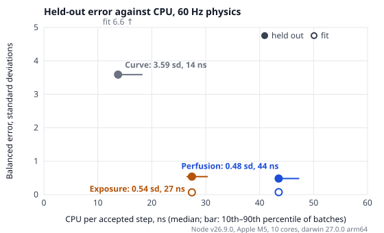

# Pilot response models: comparison and decision

Measured 2026-10-21 for the proposal
[g-vision-response-curves.md](../../fly/docs/proposals/g-vision-response-curves.md).
Everything here can be reproduced with the commands at the end.

## Decision

| Model | Kept | Role |
| --- | --- | --- |
| A. Curve | Yes | The default, unchanged, so existing flights and tuned settings keep working. |
| B. Exposure | Yes | **Proposed new default.** Held-out error 0.54 sd against Curve's 3.59, at 27 ns a step. |
| C. Perfusion | Yes | An alternative with explicit pressures. Held-out error 0.48 sd, at 44 ns a step. |
| D. Reference | Not built | No usable reference: the CGEM software's licence and source are unknown. |

All three run in the flight behind `Response [Curve / Exposure / Perfusion] ?`
in the G-forces tab, applied on the next flight. Curve stays the default until
someone chooses to switch it. Exposure is the proposed replacement:
- it is as accurate as Perfusion on the held-out data, within the evidence's resolution;
- it costs less;
- it has fewer parameters to keep honest;
- it has none of Perfusion's known gap under a suit (below).



## Candidates

- **Curve** ([curveResponse.ts](../src/curveResponse.ts)) is the original vignette, behind the new interface.
  - Load maps linearly to closure between the blackout and redout ranges, lagged by the onset and recovery times.
  - Passing out is a timer, drawn when the black closes completely.
  - It keeps no load history beyond the two vignette levels.
- **Exposure** ([exposureResponse.ts](../src/exposureResponse.ts)) keeps two debts, the retina's and the brain's.
  - Each fills while the load is above what that tissue bears and is repaid below it.
  - Sight follows the retina's debt. Consciousness is lost at a full brain debt.
  - The pilot wakes once the brain's debt has stayed low, without rising, for a dwell.
  - Suit, straining, a slow compensation and a push–pull term shift the effective load.
- **Perfusion** ([perfusionResponse.ts](../src/perfusionResponse.ts)) computes the pressure at the eye and the brain:
  - the heart's pressure, less the hydrostatic column the load pulls down;
  - cardiac and vascular reflexes driven by the carotid sinus;
  - a suit and straining that add pressure.
  - Flow below what the tissue needs drains a reserve, and sight and consciousness follow the reserves.
- **Reference** (D) was ruled out before any work. The proposal asks for a pinned CGEM release, or an independently reviewed reconstruction, but neither licence nor source could be confirmed. Its golden traces are listed as unresolved in [unresolved.json](../validation/evidence/g-response/unresolved.json).

All three share [pilotResponse.ts](../src/pilotResponse.ts). One output (peripheral loss, central loss, redout and consciousness) is updated in place, once per accepted physics step. The overlay draws `10/17·max(p, c) + 7/17·c` as the black closure, so peripheral loss alone closes the vignette to 10/17 and central loss closes it the rest of the way.

## Resource use

[g-response-benchmark.ts](../scripts/g-response-benchmark.ts), measured in Node v26.9.0 on an Apple M5 (10 cores).
- The trace is 421 s of mixed loads: high loads, both signs, ramps, repeated pulls, LOC and recovery, and rest.
- It runs in 30 interleaved rounds after 5 warmup rounds, with catch-up bursts of 2 / 3 / 6 steps at 30 / 60 / 120 Hz.
- Each model's output is folded into a checksum, so no work can be skipped.

| Model | ns per step at 30 / 60 / 120 Hz, median | 60 Hz batch spread, 10th–90th | 60 Hz, µs per simulated second | Numeric state | Profile | Heap per pilot |
| --- | --- | --- | --- | --- | --- | --- |
| Harness alone | 4 / 3 / 3 | 2.7–4.1 | 0.17 | — | — | — |
| Original `stepPilot` | 29 / 29 / 28 | 27.7–30.8 | 1.72 | 24 B | — | 298 B |
| Curve | 15 / 14 / 14 | 13.4–18.3 | 0.83 | 24 B | 64 B | 442 B |
| Exposure | 26 / 27 / 27 | 26.4–30.4 | 1.65 | 56 B | 224 B | 625 B |
| Perfusion | 43 / 44 / 43 | 42.9–47.3 | 2.61 | 80 B | 312 B | 760 B |

- **All three models fit the proposal's smallest envelope**, B's 10 µs per step and 128 B of state, by more than two orders of magnitude.
  - Exposure uses 0.27% of the CPU ceiling and Perfusion 0.44%.
  - At 60 Hz physics, Perfusion costs 2.6 µs per simulated second against B's 600 µs allowance.
  - No model allocates per step or keeps a load history.
- **Curve costs half the old `stepPilot`**, because it caches the lag coefficients for a fixed step and allocates nothing.
- **Coarse tails.** The 99th percentile of 256-step chunks stays below 160 ns a step for every model.
- **Native load read.** The flight reads the load once per accepted step, where it used to read it once per frame. At 60 Hz physics and 60 frames a second, that is the same count. The indicator reuses the last step's read.
- **Not measured: the browser.** The proposal's browser check with fly's frame profiler was not run. Its section timer cannot resolve tens of nanoseconds, so it would show only that nothing grew.

## Validation

### Evidence

The fixtures are in [validation/evidence/g-response/](../validation/evidence/g-response/). Each one reconstructs a published protocol and its observed outcome, with:
- the source and its locator;
- the spread where the source gives one;
- the protection it describes.

Of the 30 scored fixtures, 16 were used for the fit and 14 were held out:
- **Fit.** W13's rapid-onset runs, W14's offset rates, WF15's retinal timing, C54's relaxed thresholds, and E07's suit and suit-with-straining runs.
- **Held out.** W13's transitional onsets, W13 by peak load, W13's gradual onset (scored as a bracket), WW90b's offsets and E07's relaxed threshold.

**How the scores work** ([g-response-evidence.ts](../scripts/g-response-evidence.ts)):
- Errors are in the source's standard deviations.
- Each family counts once, so many easy fixtures cannot hide a failing family.
- A missed event is reported as a miss, never as an error of zero.
- A lower bound counts only a shortfall.
- A pooled-protection fixture is met if the relaxed and protected pilots bracket the observed mean.

| Model | Fit: balanced error, misses | Held out: balanced error, misses, brackets met |
| --- | --- | --- |
| Curve | 6.57 sd, 9 missed | 3.59 sd, 7 missed, 0 of 1 |
| Exposure | 0.07 sd, 0 missed | 0.54 sd, 1 missed, 1 of 1 |
| Perfusion | 0.07 sd, 0 missed | 0.48 sd, 1 missed, 1 of 1 |

By family, held out:

| Family | Curve | Exposure | Perfusion |
| --- | --- | --- | --- |
| Transitional onset, time to LOC | 3.83 sd | 0.22 sd | 0.21 sd |
| Rapid onset by peak load, time to LOC | 3.26 sd, 5 missed | 0.16 sd, 1 missed | 0.15 sd, 1 missed |
| Recovery after LOC | 2 missed | 0.17 sd | 0.18 sd |
| Relaxed thresholds (E07 relaxed) | 3.68 sd | 1.61 sd | 1.39 sd |
| Gradual onset (bracket) | not met | met | met |

What the held-out results say:
- **Curve fails every family.**
  - It never passes a pilot out below the top of its blackout range, so relaxed LOC fixtures are misses.
  - Its timer ignores how the load came off.
- **Exposure and Perfusion are equivalent on the held-out data.**
  - They are within 0.01 sd of each other in every family but one.
  - In that one, E07's relaxed threshold, both miss by more than a standard deviation: E07 measured 3.4 ± 0.5 g, Exposure gives 4.20 g and Perfusion 4.09 g. The fit's own relaxed threshold, C54's 4.1 ± 0.7 g, disagrees with E07 by about the same amount. CGEM itself predicts 4.2 g here (CGEM-R Table II).
- **The 4.5 g rapid-onset run is missed by all three.** It is a load at which only some subjects lost consciousness. A model of the mean pilot either passes out there or does not.
- **The scores do not depend on the physics rate.** Balanced errors and misses at 30 and 120 Hz equal those at 60 Hz, to two decimals.

Not scored, with the reasons kept beside the data in [unresolved.json](../validation/evidence/g-response/unresolved.json):
- X21's push–pull, which is qualitative only;
- H85;
- WW90, which is pooled;
- CGEM's golden traces, which test source fidelity rather than people.

### Mechanism checks

[g-response-compare.ts](../scripts/g-response-compare.ts) replays the proposal's synthetic families through every model. These test behaviour, not physiology. At 60 Hz, for a relaxed pilot, Exposure and Perfusion agree to within a second on almost every event.
- **Brief pulse.** +9 g for up to 1 s costs no sight: the reserves bridge it. Curve's lag starts a vignette at once.
- **Sustained.** From +6 g up, a relaxed pilot loses consciousness at 7.9 s (Exposure) or 8.0 s (Perfusion), whatever the load: the reserve plateau. Protected pilots reach the same plateau within about 1 g above their 15 s LOC threshold, so a straining pilot at +11 g goes out as soon as a relaxed one at +7 g. Both models put LOC before complete loss of sight at these rapid onsets. No fixture scores the order of these two events.
- **Ramp.** At 0.1 g/s, the relaxed pilot goes out at about 6 g, 50 s in. W13's gradual-onset mean of 74 s lies between the relaxed and protected pilots of both models.
- **Repeated pulls.** Four +6 g pulls of 5 s with 1 s between them pass a relaxed pilot out in the second pull. With 5 s between, sight starts to go in the second pull and the pilot stays conscious. With 20 s between, Exposure still shows symptoms at the end of the second pull, and Perfusion shows none. Curve carries over only the vignette that has not yet cleared.
- **Push–pull.** At +6 g, a relaxed pilot is past the plateau and the push changes nothing. At +4.5 g, Exposure loses sight completely after a −1 g push and keeps it after +1 g. Perfusion's symptoms come 1.4 s earlier. This is qualitative only (X21).
- **Unload after LOC.** A quick unload brings a relaxed Exposure pilot to 6.6 s after it starts. A 9 s unload brings them to 11.6 s after it starts, so recovery depends on the restored supply. Curve's timer gives the same time for both.
- **Pull during recovery.** A pull 4 s into recovery keeps the pilot out until 6.4 s after it ends. Neither model has a timer-only awakening: Exposure's wake dwell restarts while the brain's debt rises.

Integration. [responseModels.test.ts](../tests/responseModels.test.ts) compares each model with ~1 ms substeps of the same load:
- every event lies within one physics step at each rate, and the closure within 0.005;
- on a restless trace for the protected pilots, the worst cases are 26 ms at 30 Hz (step 33 ms), 14 ms at 60 Hz (step 17 ms) and 7 ms at 120 Hz (step 8 ms).

The same tests cover:
- bounded and finite state;
- no change at zero time;
- reset, and edits that keep state;
- grouping steps into frames.

## Fit

[g-response-fit.ts](../scripts/g-response-fit.ts) fits each model's relaxed preset to the fit fixtures alone, by a bounded pattern search.
- **Cost.** The squared error in the source's standard deviations, 25 for a miss, averaged within families and then over them.
- **Perfusion's bounds** are physiological:
  - intraocular pressure 12–21 mmHg;
  - full-flow pressures 10–60 mmHg;
  - eye-to-brain column 25–40 cm;
  - the pressure around the brain −25 to 0 mmHg.
- **Protection** is then solved by bisection on the relaxed symptom threshold: the suit to +2.9 g over it, and straining to 9.0 g. These are E07's suit and suit-with-straining runs, which are lower bounds, because the runs stopped there.

| Exposure, `exposure-*@2` | Value |
| --- | --- |
| Retina bears, fully drained at | 2.3 g, 4.4 g |
| Brain bears, fully drained at | 3.25 g, 5.1 g |
| Buffers: retina, brain | 9 s, 7.9 s |
| Repayment: retina, brain | 4.1 s, 2.8 s |
| Peripheral loss from–to, central loss from | debt 0.45–0.99, 0.79 |
| Wake below, held | debt 0.64, 5.1 s |
| Suit, straining | 2.9 g, 1.9 g |

| Perfusion, `perfusion-*@2` | Value |
| --- | --- |
| Heart, eye and brain above it, carotid | 120 mmHg; 30 cm, 36 cm; 20 cm |
| Intraocular, peripheral retina, around the brain | 21, 4.2, −11.5 mmHg |
| Full flow: retina, brain | 60, 56 mmHg |
| Reserves: retina, brain; refill gain | 9 s, 8 s; 2.1 |
| Wake at reserve, held | 0.44, 4 s |
| Suit: from 1 g, per g, at most | 15.2 mmHg, 121 mmHg |
| Straining | 35 mmHg |

**Not fitted:**
- Perfusion's reflex gains and time constants;
- Exposure's compensation and push–pull terms, which keep their mechanism-test values for want of data;
- redout in every model, which reuses Curve's −2 to −3 g range.

**Rounding.** The protection values are rounded results of the solve: the script now gives 122 mmHg and 34.3 mmHg for the last two Perfusion rows. Both versions meet E07's bounds.

**Perfusion's suit is an effective suit.** CGEM's schedule, 9 mmHg per g up to 72 mmHg from 1 g, buys only +1.3 g here. The carotid reflex answers the added pressure by lowering the heart's output, and the model does not lift the heart, as a real suit does. So the suit is solved as about 1.7× CGEM's, to give E07's +2.9 g.

## Applying the selection rules

1. **Stability and envelope.** All three are stable and converge within one step at every rate, and all fit the smallest envelope. None is rejected.
2. **Domination.** No model is no worse than another on both accuracy and cost.
   - Curve is cheapest and far worst.
   - Perfusion is slightly more accurate than Exposure and costs more.
3. **First knee: Exposure.** It lowers Curve's held-out error by 85% and turns 7 misses into 1.
4. **Second knee: none.** Perfusion lowers Exposure's held-out error by 11%, below the 15% review trigger.
   - That gain is within the evidence's resolution: one fixture of 14 carries it, and both are more than a standard deviation off that fixture.
   - Perfusion adds no validated transfer. Its protected pilot fails a check Exposure passes: Burton's suited gradual-onset tolerance lies 0.7–1.1 g above the rapid-onset one (CGEM-R Table I), and Perfusion's lies only 0.19 g above.
   - That check is marked as an expected failure in [responseModels.test.ts](../tests/responseModels.test.ts).
5. **Collapse the tiers.** Every model fits the cheapest envelope, so the choice falls to accuracy and maintainability.
   - Exposure is as accurate as Perfusion, has 28 parameters to Perfusion's 39, and has no known protection gap.
   - Perfusion stays available because its pressures can be checked against physiology one at a time, and because it is the natural home for a better suit.
   - Curve stays as the compatibility default.

## Gaps

- **Redout.** No negative-load data was scored. Every model uses Curve's −2 to −3 g range, and that branch is unvalidated.
- **Straining never tires.** E07 stops at 8.9 g, so a protected Exposure pilot survives 10 g held for 20 s and goes out only at about 10.2 g. Loads beyond 9 g for a protected pilot are extrapolation.
- **Perfusion under a suit.**
  - The effective suit cancels the reflex.
  - The gradual-to-rapid-onset gap is too small (above).
  - A suited Perfusion pilot loses consciousness at 8.2 g, before complete loss of sight at 8.9 g.
- **Held-out independence.** Most held-out fixtures come from W13, the same study as the rapid-onset fit fixtures. Only WW90b and E07's relaxed run come from other studies.
- **Protection in W13 is pooled**, which is why its gradual onset is scored as a bracket.
- **Seat angle is mixed across fixtures.** The models have one upright seat.
- **The symptom event.** It is read as peripheral loss reaching 0.1, where sources describe the loss of peripheral light, defined differently from study to study.
- **E07's relaxed threshold** is missed by both fitted models, and by CGEM.
- **The mean pilot.** No model covers the spread between pilots: the 4.5 g rapid-onset run is a miss.
- **Push–pull** is qualitative only.
- **Not done:** the browser frame-profiler check, and Reference (D).

## In the flight

fly's [createFlightPilot.ts](../../fly/src/flight/createFlightPilot.ts) builds the chosen model from the settings. The flight advances it once per accepted physics step, with that step's load and length.
- **Controls.** A pilot who passes out lets go of the stick, pedals and brakes from the next step, even within one frame.
- **Logs.** Logs are written only on a transition, with the response's versioned profile id.
- **Settings.**
  - Edits within a response keep the pilot's state.
  - A change of response waits for the next flight.
  - Passing out stays opt-in.
  - With the vignettes and passing out both off, nothing is followed, as before.
- **Preview.** The G-forces tab shows a preview of the chosen response, replayed through a private pilot at the next flight's physics rate.

## Reproduce

From `g-forces/`:

```sh
node scripts/g-response-compare.ts [--hz=60]          # tables and scores, to build/g-response/
node --expose-gc scripts/g-response-benchmark.ts     # cost, to build/g-response/
node scripts/g-response-plot.ts                      # this page's plot, from the newest of each
node scripts/g-response-fit.ts exposure|perfusion    # the fit (minutes)
```

The plot on this page is from `compare-2026-10-22T03-04-41-850Z.json` and `benchmark-2026-10-22T02-58-29-310Z.json`, at 60 Hz.
